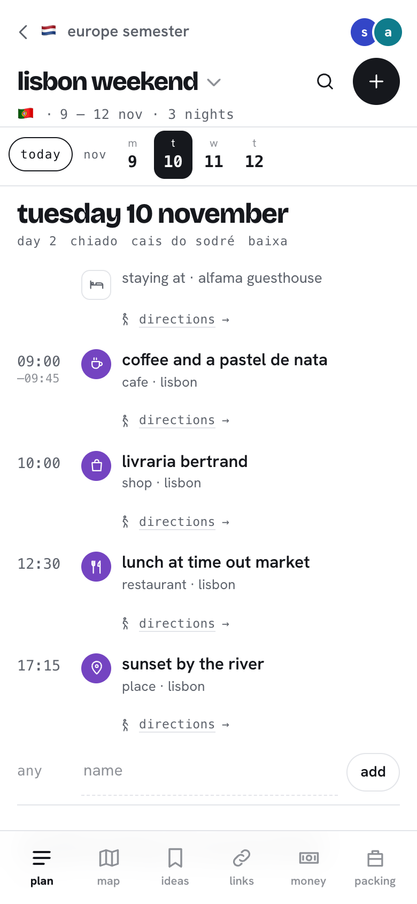
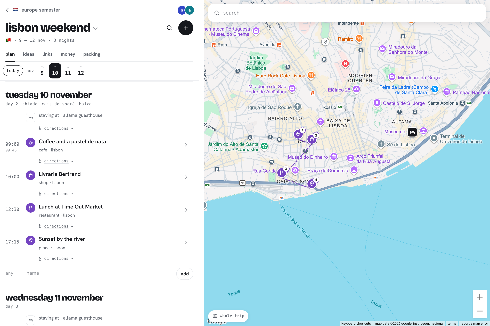

# planner

a little travel planner for two. i made it to plan my europe exchange with a friend: one long semester abroad with a bunch of side trips inside it. tried to find websites suited for this, but wanderlog didn't like how long our trip was, so i built my own.

## what it does

- **trips inside trips.** one big trip (the semester) with side trips inside it (lisbon, rome, …), as deep as you want.
- **day by day plan.** every day gets a card with numbered stops, how long the walk is between them, and drag to reorder. stays show up on every night you're there, flights and trains show their times.
- **search for places.** type a place and add it to a day, or save it for later.
- **map.** every stop is a pin in its day's colour, with the day's route drawn between them. tap anywhere to add or save a spot, or open it in google maps.
- **money.** prices in any currency, converted with live rates. a budget bar, totals by category, who paid what, and who owes who.
- **tickets.** attach pdfs and screenshots to a booking. once opened they stay on your phone, so they work without signal.
- **saved stuff.** instagram reels, tiktoks, youtube videos and random links, kept with the trip they're for.
- **packing list.** tick things off as you pack.
- **a globe on the home page** that spins and fills in every country we've been to or are going to. tap a country to jump to that trip.
- **works offline.** everything is viewable without internet (editing waits until you're back online).
- **shared and live.** we both sign in with our email, and changes show up on the other person's phone straight away.
- **private.** the site is public but the data isn't: only the emails on the list can see or change anything.
- **add to home screen** on an iphone and it opens like an app.

## what it's made with

react, vite and typescript, hosted for free on github pages. supabase for sign-in, the database (with row level security so only members can read anything), live updates and ticket storage. maplibre with openfreemap for maps, photon for place search, the osrm foot router for walking times, and frankfurter for ecb exchange rates. all free.
