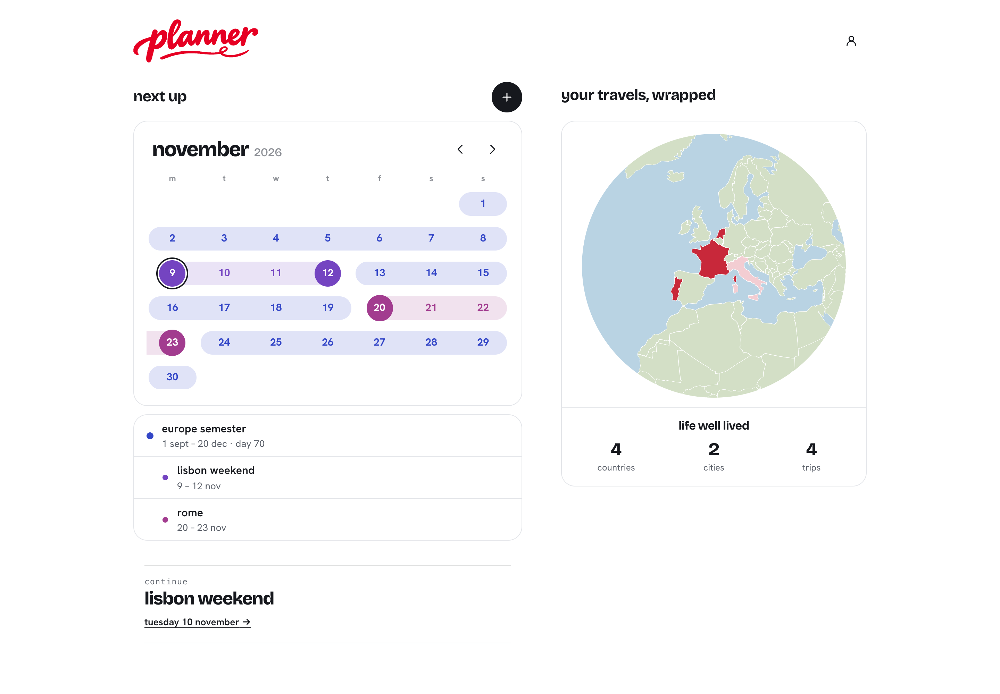
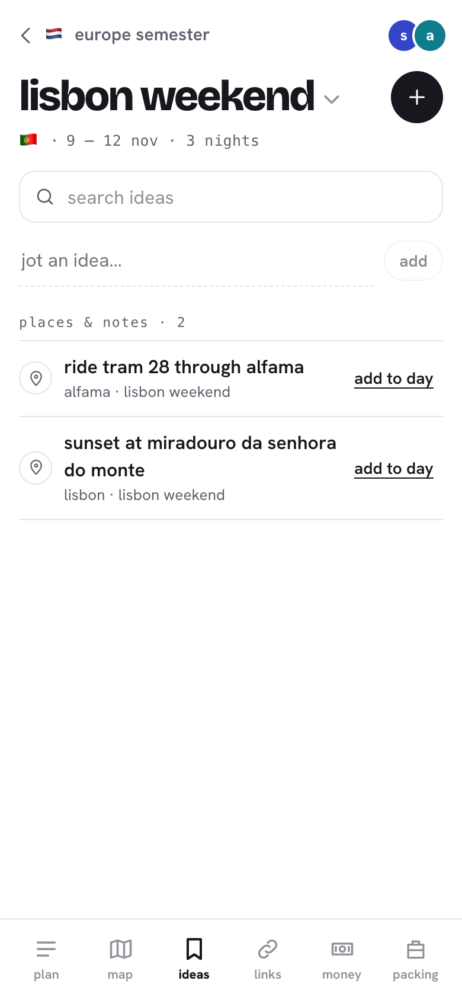
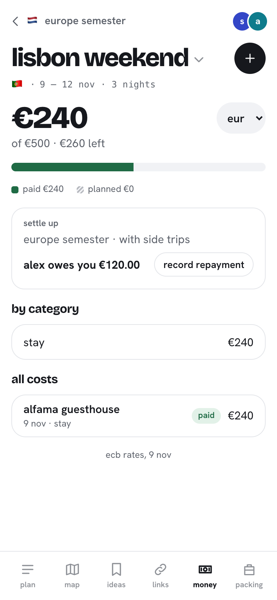

# planner

a little travel planner for two. i made it to plan my europe exchange with a friend: one long semester abroad with a bunch of side trips inside it. tried to find websites suited for this, but wanderlog didn't like how long our trip was, so i built my own.

## what it does

- **trips inside trips.** one big trip (the semester) with side trips inside it (lisbon, rome, …), as deep as you want. the long trip has a calendar of weekends away; open one to get to its day-by-day plan. the semester can have its own activities too.
- **the plan is one document.** each day's places, notes, journeys and stays, with walking times between places. jump to a date, search the plan, or drag lines (or use the arrow keys) to reorder them. stays show up on every night you're there.
- **a map beside the plan.** on a laptop it stays on the right and follows the day you're reading. on a phone it has its own tab. numbered pins, walking routes, a whole-trip view, and links out to google maps when it's time to go.
- **places have a kind.** café, restaurant, museum, park, shop, stay… each with its own icon. search with google places when it's set up (openstreetmap otherwise), or just write something down.
- **ideas before dates.** jot a place or a note without deciding when to go. search your ideas and put one on a day when you're ready. whole side trips can wait without dates too.
- **links have their own place.** instagram reels, tiktoks, youtube videos and random pages: share them to the planner or paste them in. on an iphone a shortcut in the share sheet asks which trip and saves it there without leaving instagram (it signs in with a save key from the account sheet). keep them in the home inbox, file them under a trip, or attach them to a place.
- **bookings and tickets.** mark something to book or booked, keep the reference and booking link, and attach pdfs or screenshots. overlapping stays and side trips get a heads-up in the plan.
- **money.** paid costs and estimates, a budget, totals by category and currency conversion. split a cost evenly or by exact amounts, see who owes who across the whole trip, and record a payback.
- **packing.** a little checklist for each trip, with room for your own things.
- **your own reviews.** after a trip, each of us can mark a visit done or skipped, rate it, say whether we'd return and leave a note. past visits to the same place show up there too.
- **home is where you left off.** the trip you're on (or the next one) leads, with upcoming trips and side trips under it and past ones below. an inbox holds links that don't have a trip yet (sort them one by one or several at once). travels is a spinning globe that colours the countries we've been to or have planned, with a scrapbook underneath: tickets for every flight and train (open one and the globe draws its routes), a passport stamp for each country, and polaroids of our favourite places.
- **works offline.** previously loaded plans and tickets saved on the device stay readable without signal. editing, place search and the trip map need a connection.
- **shared and live.** we both sign in with our email, and changes show up on the other person's phone straight away. the site is public but the trip data is only for the emails on the list.
- **add to home screen** on a phone and it opens like an app.

## a little look around

home, with the next trip and everything coming up:

ideas for later, and keeping track of what we've spent:

 

screenshots use a made-up trip, taken from the current app.

## what it's made with

react, vite and typescript, hosted for free on github pages. supabase for sign-in, the database (with row level security so only members can read anything), live updates and ticket storage. google maps for the trip map, place search and walking routes, maplibre for the home globe, photon and the osrm foot router when google isn't set up, and frankfurter for ecb exchange rates.

## want to try it?

if you want to try it, let me know.
